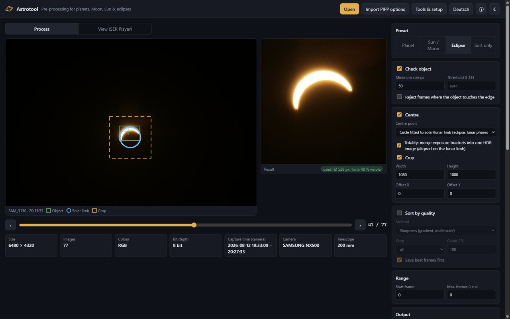
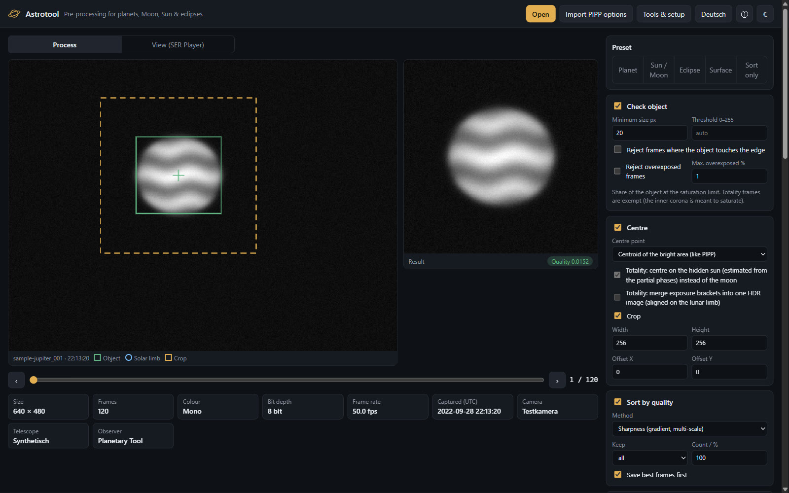
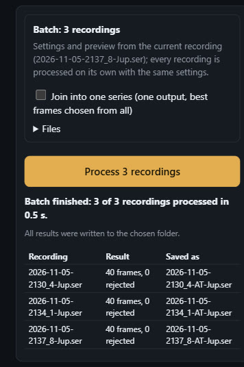
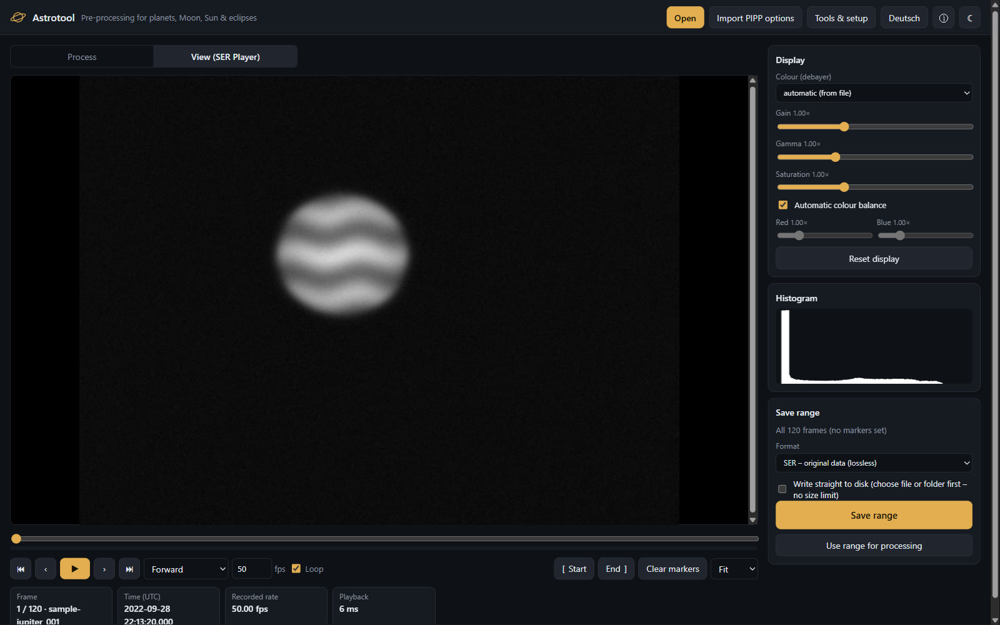
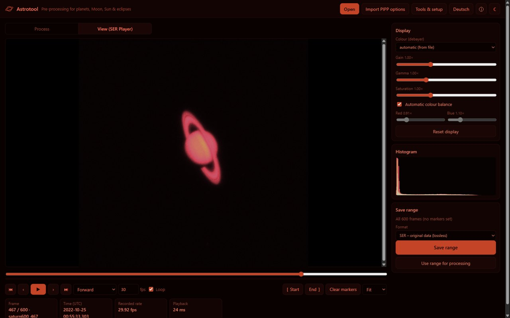
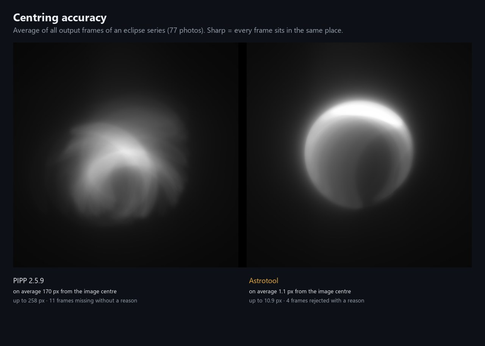

# Astrotool

**English** · [Deutsch](README.de.md)

**Pre-processing for planetary, lunar, solar and eclipse imaging** – a modern successor to PIPP (Planetary Imaging PreProcessor, last released as 2.5.9 in 2017).

Astrotool prepares videos and image series for stacking software such as AutoStakkert!, RegiStax or PlanetarySystemStacker. It finds the object in every frame, centres it and crops away empty background. Unusable frames (object missing, too small, touching the edge, overexposed) are rejected, the rest are ranked by sharpness, and only the best are kept. That saves disk space and makes stacking faster and better.

**Try it in your browser: [astrotool.ai-suisse.com](https://astrotool.ai-suisse.com)** – nothing to install, your photos stay on your device. For regular use there is the Windows app (below).



## Highlights

- **Planets** – Jupiter, Saturn, Mars & co. stay centred despite seeing and tracking errors; frames sorted by sharpness, best N or best % kept.
- **Whole observing sessions at once** – open dozens of SER/AVI recordings or a folder of image series, process each with the same settings into one folder, named for **WinJUPOS** derotation – or join recordings into one series.
- **Eclipse film in one click (Easy mode)** – for travellers without astronomy know-how: drop all photos of the eclipse (camera or phone, any interval, also zoomed differently), Astrotool sorts out shaken, blown-out and non-sun shots, keeps the sun centred at one size and makes a 1080 × 1080 MP4 that runs at an even pace – frames between your photos are calculated, with the moon where it was at that moment (0.34).
- **Easy mode to enjoy (0.36)** – a starry sky and a drawn eclipse welcome you. While Astrotool works you watch it: every photo appears with the circle it found, the film strip grows, sorted-out photos say why. The finished film plays large like in a cinema, with a timeline of your photos underneath – tap one to jump there – and on phones a button to share it. The website starts in your browser's language and is laid out for phones.
- **Lunar eclipses, phone photos and more formats (0.35)** – the Easy mode also makes a film of a **lunar eclipse**: the moon stays centred at one size across all zoom levels, landscape shots with a tiny moon are sorted out. **iPhone photos (HEIC)** are read directly (portrait shots upright), and the film can be square, 9:16 (status, Reels) or 16:9. Large photos are analysed about 2.5 times faster, and gaps of 20 minutes and more between photos are bridged without artefacts.
- **Solar eclipses** – a circle is fitted to the solar limb instead of using the brightness centroid, so the sun stays put even on a thin crescent. During **totality** the frames are aligned on the lunar limb, and exposure brackets are merged into one **HDR** image showing inner corona, prominences and outer corona together.
- **Time-lapses** that are ready to share – MP4 H.265/HEVC or H.264 (plays in WhatsApp and Google Photos and is filed under the capture date), WebM or GIF, with capture time and title burned in.
- **Every common input** – SER, AVI (SharpCap, FireCapture & co., also > 4 GB), MP4/MOV/MKV/WebM, JPG/PNG/TIFF, iPhone HEIC and camera RAW (sensor data from DNG – also Fujifilm X-Trans – Canon CR2, Sony ARW, Nikon NEF, Samsung SRW and uncompressed Fujifilm RAF; full-size embedded image for CR3, compressed RAF and others, with a hint to convert them to DNG). No extra software needed.
- **Built-in viewer** (an independent re-implementation of the classic SER Player idea): play forwards/backwards at 30 fps, set markers, debayer, gain, gamma, colour balance, histogram, save a range or hand it to processing.
- **Made for the night** – English and German UI, red night mode, PIPP option files (`.pof`) can be imported.

| Planet: preview and result | Batch with WinJUPOS file names |
|---|---|
|  |  |
| **Viewer (SER Player style)** | **Night mode for the telescope** |
|  |  |

Planet screenshots use the synthetic test recording that `npm run sample` creates.

### Accuracy compared with PIPP

On a real series of 77 photos of the partial solar eclipse of 12 August 2026, PIPP's centred output was on average **170 px** off the true solar centre; Astrotool's was **1.1 px** off.



## Download and install (Windows 10/11)

Astrotool is a native Windows app (Tauri 2, about 9 MB). The installer works per user without administrator rights; a portable `.exe` is available as well. Nothing else has to be installed – FFmpeg is optional and only used for H.265 encoding (one click in *Tools & Setup*).

The app is not code-signed yet, so Windows SmartScreen may show *"Windows protected your PC"* on first start. Click **More info** → **Run anyway**. Download Astrotool only from this repository's releases page.

**macOS and Linux (experimental, since 0.35):** the releases also contain a universal `.dmg` for macOS (Apple Silicon and Intel) and an AppImage and `.deb` for Linux. They are built and start-tested automatically on GitHub, but have not been tried on real machines yet – feedback is welcome. The macOS app is not notarised by Apple: on first start macOS refuses to open it; allow it under *System Settings → Privacy & Security → Open Anyway*.

## Feature overview

| Feature | PIPP switch | Status |
|---|---|---|
| Read SER (8/16 bit, mono/Bayer/RGB, timestamps, repair of files with "0 frames" in the header) | – | ✅ |
| Read AVI: 8/16-bit mono, raw Bayer, 24/32-bit BGR, MJPEG, files > 4 GB (OpenDML) | – | ✅ |
| Read MP4, MOV, MKV, WebM via the system video decoder, capture date from metadata | – | ✅ |
| Image series (JPG, PNG, TIFF, camera RAW), sorted by EXIF capture time | – | ✅ |
| Camera RAW: 16-bit linear Bayer sensor data from DNG, CR2, Sony ARW (lossless, lossy "cRAW" and uncompressed, 0.27), Nikon-compressed NEF, Samsung SRW (NX1/NX500, NX300 family incl. NX300M and NX2000, NX100 family, 0.27/0.30) and Fujifilm RAF with Bayer sensor (e.g. X-A5, 0.27); white balance from the camera (NEF, SRW) or derived from the camera's own image | – | ✅ |
| Object check, minimum size, automatic/manual threshold | `-chk -ms= -mp=` | ✅ |
| Reject overexposed frames (share of the object at saturation; totality exempt) (0.26) | `-oe=` | ✅ |
| Edit frames: greyscale, mirror, rotate by 90/180/270°, resize in % (0.26) or to width × height (0.29); gain, histogram stretch (target, black point, per colour) and gamma (0.29) – raw Bayer data stays raw for tone changes, mirroring and rotating | `-convmono -flip_x -flip_y -rotate90 -resize_en -resize_width= -resize_height= -input_gain= -hs= -hs_bp -hsrgb -gamma=` | ✅ |
| Centre, crop, offset (Bayer-safe) | `-ctr -cx= -cy= -ox= -oy=` | ✅ |
| Quality: multi-scale sharpness, brightest pixel, brightness | `-q -qmin= -qmax= -qinc= -qhisto -qtotal` | ✅ |
| Keep best N / best %, ordering | `-q= -qpcnt= -nr` | ✅ |
| Debayer for colour cameras; SER output in colour or as raw Bayer data | `-db -db= -pb` | ✅ |
| Write SER (timestamps preserved), PNG frames as ZIP or into a folder, CSV log | `-ser -png` | ✅ |
| WinJUPOS file names (capture time in UT with tenths of a minute, observer code, further details; video named by its start, middle or end; time from the file, the SER header or the file name, can be shifted) (0.29) | `-wjpos_*` | ✅ |
| Batch: several SER/AVI/video recordings in one run, same settings, one output each into a chosen folder (SER file or a sub-folder of frames, plus time-lapse/montage), summary table; or joined into one series with best frames chosen from all (0.31). "Open folder" (or drop folders): every sub-folder of images becomes one image series of the batch, every video one recording; other files are skipped (0.32) | several inputs, `-join` | ✅ |
| Write straight to disk while processing (SER to a file, frames to a folder), also when saving a range from the viewer – no memory limit; ZIP64 for archives > 4 GB | – | ✅ |
| Full-depth frames: 16-bit PNG, 16-bit TIFF and FITS (capture time, exposure, Bayer pattern in the header) for Siril, PixInsight, DeepSkyStacker | TIFF, FITS | ✅ |
| Eclipse mode: circle fit to the solar limb, plausibility check on the radius | – (new) | ✅ |
| Easy mode for eclipse series: one button from photos to MP4 (1080 × 1080, H.264). Sorts by capture time, keeps only the camera with most photos, rejects shaken/blurred frames (solar limb wider than in neighbouring frames), blown-out frames and pictures without a sun (landscapes, people); evens out different zoom; crop from the size of the sun; time-true timeline: irregular intervals run evenly, gaps are filled with calculated frames (moon shifted along its path), totality slower; plain-language summary (0.34) | – (new) | ✅ |
| Easy mode, live view and cinema: while processing, each photo with the fitted circle and a growing film strip (previews handed over from the worker, no measurable extra time); the result with a timeline of the photos that jumps to their place in the film; share button where the device can share files (0.36) | – (new) | ✅ |
| Easy mode for lunar eclipses: the lunar limb is fitted (the Earth's shadow has no sharp edge); every plausibly measured photo is kept whatever its zoom, night shots without a moon are rejected (little limb, large scatter); frames between the photos are cross-faded (0.35) | – (new) | ✅ |
| iPhone photos (HEIC/HEIF): file structure read natively (grid of HEVC tiles, rotation, Exif), decoded with the system's HEVC decoder via WebCodecs – no third-party library (0.35) | – (new) | ✅ |
| Film format in Easy mode: square, portrait 9:16 or landscape 16:9, title and time above and below the picture; shorter film for few photos (0.35) | – (new) | ✅ |
| Fast analysis of photo series: the object is located in a reduced view, only the region around it is read at full resolution – 77 photos of 28 MP in 64 s instead of 160 s (0.35) | – (new) | ✅ |
| In-between frames across long gaps (moon moved by more than a quarter of the solar radius): a model of the photo – brightness by distance from the edge of the visible sun – instead of shifting; the lunar limb is re-measured on each photo (0.35) | – (new) | ✅ |
| Totality: alignment on the lunar limb, exposure brackets merged to HDR, sky glow and its gradient removed (0.23); the camera's tone curve is measured from each bracket, so camera JPEGs blend without rings, and false limbs around the contacts (crescent, diamond ring, overexposed inner corona) are rejected (0.33) | – (new) | ✅ |
| Eclipse phase montage: selected frames as an arc (path of the sun), row or grid, totality in the middle, time under each disc, one large PNG | – (new) | ✅ |
| Time-lapse: HEVC, H.264, WebM, GIF; frame rate, hold last frame, ping-pong, time and title overlay | `-anim_fwd -anim_rev -anim_fwd_lf_rep= -fps_rate= -gif` | ✅ |
| Import PIPP option files (`.pof`) | – | ✅ |
| Viewer (SER Player style), night mode, English/German UI, list of recently opened files (0.28) | – | ✅ |
| Dark/flat calibration: masters from SER, video, image or RAW series (average without the highest and lowest value), flat dark/bias, colour-neutral flats for Bayer data; applied before cropping and debayering; darks scaled to a different exposure, masters saved and loaded as FITS (0.28) | dark/flat | ✅ |
| Reading FITS: single images (grey, Bayer, colour; 8/16/32 bit, float) with time and exposure from the header – also as darks/flats; cubes with many frames in one file (0.25) open like a video; compressed FITS (`.fits.fz`: Rice, GZIP, quantised float, as from fpack and solar observatories such as NSO/GONG) (0.30) | FITS | ✅ |
| Fujifilm X-Trans sensor data (uncompressed RAF, DNG) with own colour reconstruction; compressed CR3/RAF: Canon/Fuji do not publish the format – convert with the free Adobe DNG Converter | – | ✅ |
| Surface stabilisation for lunar/solar close-ups without a full limb: every frame aligned to the first by its surface structure (own FFT, sub-pixel), frames without matching structure (clouds) rejected; optional anchor box drawn in the preview (0.24); reference follows slowly changing structure in long series, image rotation (field rotation) detected and corrected (0.28) | surface feature | ✅ |

Everything runs locally – your files never leave your computer.

## Building from source

Requirements: Node.js 22 LTS (or 20.19+), and for the Windows app Rust and the Visual Studio Build Tools (details in [docs/windows-app.md](docs/windows-app.md)).

```bash
cd web
npm install
npm run app:build   # Windows installer and portable exe
npm run dev         # the same user interface in the browser, http://localhost:5173
npm test            # unit tests
```

Without your own recordings: `npm run sample` creates `sample-jupiter.ser` (a synthetic planet with seeing).

The app is tested end to end with a script that drives the finished `.exe` like a person would (`web/scripts/app-fulltest.mjs`, 56 checks across SER, AVI, MP4, RAW, FITS, eclipse, totality and surface stabilisation).

## How it is built

| Path | Content |
|---|---|
| `web/src/engine/` | the processing engine in TypeScript, no DOM dependency: SER/AVI/RAW readers, lossless-JPEG decoder, detection, limb fitting, quality, HDR |
| `web/src/` | user interface, Web Worker, viewer, time-lapse encoder |
| `web/src-tauri/` | Windows app (Rust): native file handling, FFmpeg bridge for HEVC |
| `docs/` | design notes, test data and results, roadmap |

## Background

PIPP is freeware by Chris Garry; its source code was never published. Astrotool contains **no code and no binaries** from PIPP or SER Player. PIPP was studied only to understand its feature set, options and file formats (for example to import `.pof` files); all algorithms are implemented independently from public specifications (SER format, TIFF/DNG, RIFF/AVI, ITU-T T.81) and the literature. Notes: [docs/reverse-engineering](docs/reverse-engineering/).

## Privacy

The web version at astrotool.ai-suisse.com is the same program, delivered by GitHub Pages; as with any website, the host (GitHub) sees the address your browser connects from. Your photos and videos are processed in your browser and are never uploaded.

This program will not transfer any information to other networked systems unless specifically requested by the user or the person installing or operating it. Astrotool works offline on your own files. The installer downloads Microsoft WebView2 only if it is missing on the computer; helper tools such as FFmpeg are installed via winget only when you click *Install* in *Tools & Setup*.

## Contributing

Bug reports and test recordings are very welcome – especially eclipse series and RAW files from cameras that are not supported yet. Code contributions require agreeing to a contributor licence agreement, see [CONTRIBUTING.md](CONTRIBUTING.md).

## Licence

Astrotool is free software under the **GNU General Public License, version 3 or later** (GPL-3.0-or-later), © 2026 aisuisse – see [LICENSE](LICENSE). Third-party libraries: [THIRD_PARTY.md](THIRD_PARTY.md).
